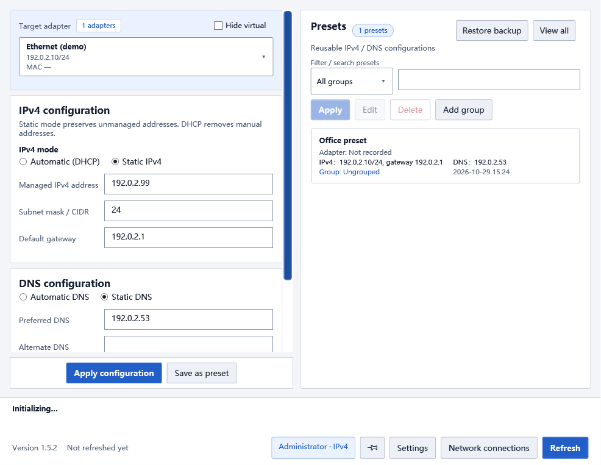

# NetAdapterManager

[简体中文](README.md) | English

An IPv4, DNS and network preset manager for Windows 10/11 x64, built with WPF and .NET 8.
Current source version: **1.5.2**. Licensed under the [MIT license](LICENSE).



## Features

- View physical, virtual and VPN adapters. Switch between DHCP and static IPv4, with independent automatic or static DNS.
- Save, edit and apply adapter-specific presets. Organize them into groups, search, move or delete multiple presets.
- Capture configuration before changes, verify the result and attempt rollback on failure.
- Enable or disable adapters, keep the window on top and open Windows Network Connections.
- Switch between Simplified Chinese, Traditional Chinese, English and the system language in Settings.
- Choose light, dark or system theme, with support for Windows high-contrast colors.
- Right-aligned toolbar controls, with version and refresh time on the left.

Network changes require administrator privileges; Windows displays a UAC prompt at startup. Changing the active adapter may interrupt connectivity, so check the target adapter before applying changes.

## Download and use

Download a Windows x64 package from [GitHub Releases](https://github.com/FlavorFiesta/NetAdapterManager/releases/latest):

- `NetAdapterManager-v<version>-Setup-win-x64.exe`: installation wizard, defaulting to `%LocalAppData%\Programs\NetAdapterManager`.
- `NetAdapterManager-v<version>-portable-win-x64.zip`: extract the entire archive and run `NetAdapterManager.exe`. Keep all extracted files together.
- `SHA256SUMS.txt`: SHA-256 checksums for both packages.

Packages include the .NET runtime. The installer preselects a supported language based on the Windows display language, with English as the fallback; you can select another language before installation. The first application launch uses the installer language. Portable installations initially follow the system language. Existing language and theme settings survive upgrades.

Language changes are temporarily disabled during network operations. Windows controls the appearance and language of native dialogs and raw system error messages.

## What's new in 1.5.2

This release includes all changes developed in the local 1.5.0 and 1.5.1 candidates: languages, themes, installer language selection, toolbar alignment and reliability improvements. It also fixes stale editor values after a successful preset application and makes composed status messages update when switching languages. See the [bilingual release notes](docs/RELEASE-1.5.2.md) and [full changelog in Chinese](CHANGELOG.md).

## Data and privacy

Application data lives beside the executable: `preset-library.json` (presets and groups), `managed-addresses.json` and `settings.json` (language and theme). Errors are logged to `logs/NetAdapterManager.log`. Upgrades preserve data; uninstalling may leave generated data files behind.

The unified preset library introduced in 1.4.12 imports legacy `presets.json` and `preset-groups.json` from the application directory, or from `%AppData%\NetAdapterManager` if local legacy files are absent. Successful saving creates the unified library and retains the originals. Once the unified library exists, legacy files are no longer imported. Downgrading to 1.4.11 does not expose subsequent unified-library changes; preserve the full application directory first.

Replacing an existing data file keeps its previous contents as `.bak`. Restore Backup restores presets and groups together, validates the backup first and preserves the replaced file as `.corrupt-*`. Corrupt or inaccessible preset data is reported and protected from overwriting. Damaged settings are preserved when a new preference is saved.

Only one instance runs per user. Closing during configuration, verification or recovery waits for the operation to finish; this cannot protect against forced termination or power loss. Adapter enable/disable operations stop waiting after 15 seconds, but Windows may still be working. Further writes are blocked; inspect the system state before restarting the app.

Preferences are stored per application directory. Running the same installation under another elevated account uses the same explicit preferences; system defaults refer to the account running the application. User-created names are never translated.

Presets, screenshots and logs may reveal adapter names, MAC addresses, IP addresses and DNS servers. Remove personal information before sharing them. Runtime data, build outputs and local test evidence are excluded from Git. The screenshot above uses synthetic adapters and documentation example addresses.

## Build and test

Requires Windows 10/11 x64 and the .NET 8 SDK. Building the application does not require Python or Inno Setup.

```powershell
dotnet restore .\NetAdapterManager.csproj
dotnet build .\NetAdapterManager.csproj -c Release --no-restore
dotnet run --project .\tests\NetAdapterManager.SelfTest -c Release
powershell -NoProfile -ExecutionPolicy Bypass -File .\tests\Run-FullTest.ps1
```

The default tests read system network state and write isolated test files and logs. Command-generation checks capture commands for synthetic adapters; they do not change real network settings.

```powershell
# Regression tests without real adapters, WMI or user data
dotnet run --project .\tests\NetAdapterManager.SelfTest -c Release -- --isolated
# Three languages combined with light/dark themes, using synthetic data
dotnet run --project .\tests\NetAdapterManager.SelfTest -c Release -- --appearance-smoke
```

CI builds the project, runs isolated regressions and queries dependency vulnerabilities. Local full tests require adapters for read-only WMI checks. Real write tests require the explicit `-RunSafeWriteTest` option and administrator privileges; use only an eligible virtual adapter with a static IPv4 address and no default gateway. Never run write tests on the active connection.

DNS mode is read independently from IP DHCP state using the Windows DNS settings API, with a read-only registry fallback on older Windows 10 systems. Changes and rollback verify the full IPv4 address set, gateway and DNS. DNS-only edits do not rewrite static IP addresses. Command cancellation or timeout must confirm process termination before recovery begins.

## Package

Additional requirements: Python 3, Pillow 11.1.0 and Inno Setup 6.5.0+ (6.x).

```powershell
python -m pip install -r .\build\requirements.txt
powershell -NoProfile -ExecutionPolicy Bypass -File .\build\Build-Packages.ps1
```

Outputs are self-contained, untrimmed, multi-file `win-x64` packages in `artifacts\1.5.2\`. The script replaces only the named ZIP and installer, collects dependency licenses and rejects runtime user data in the publishing directory. `-OutputRootOverride` must point inside `artifacts`, without symlinks or junctions. Version numbers come from the main project. The `.iss` script is the production installer; the C# project under Installer is a legacy prototype.

Publish both packages and matching SHA-256 checksums. Do not package an application directory that has been used with personal data.

## Contributing

Issues and pull requests are welcome. Include your Windows version, reproduction steps and expected/actual behavior; redact logs and screenshots. Run the build and default self-tests before submitting code. Real adapter write tests are not required for ordinary contributions.

See [third-party notices](THIRD-PARTY-NOTICES.md) for bundled materials. Internal working notes and raw acceptance logs remain local.
