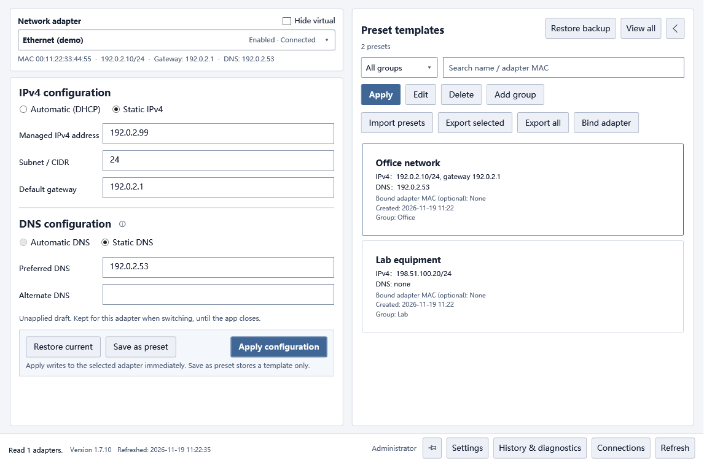
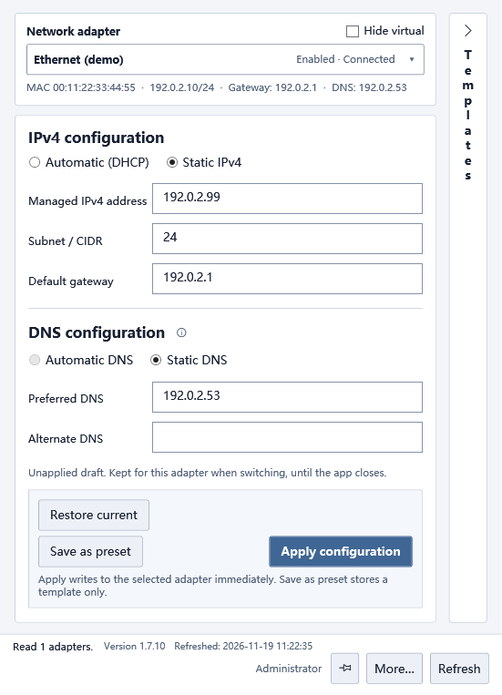
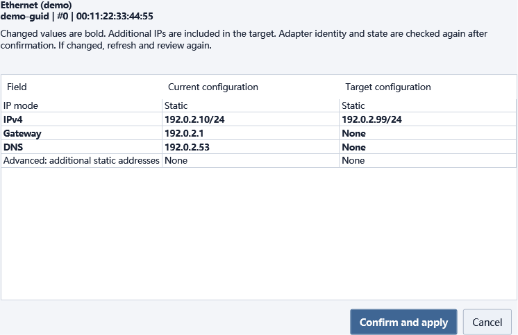

<p align="center">
  
</p>

<h1 align="center">NetAdapterManager</h1>

<p align="center"><strong>Switch IPv4, DNS, and network presets on Windows.</strong></p>

<p align="center">
  <a href="https://github.com/FlavorFiesta/NetAdapterManager/releases/latest"><strong>Download latest release</strong></a>
  · <a href="#quick-start">Quick start</a>
  · <a href="CHANGELOG.md">Changelog</a>
  · <a href="README.md">简体中文</a>
</p>

<p align="center">
  <a href="https://github.com/FlavorFiesta/NetAdapterManager/actions/workflows/build.yml"></a>
  · <strong>Windows 10 / 11 x64</strong> · <a href="LICENSE">MIT</a>
</p>

<picture>
  <source media="(prefers-color-scheme: dark)" srcset="docs/images/main-window-en-dark.png">
  
</picture>

<sub>Captured in v1.7.10 with a synthetic adapter and documentation example addresses.</sub>

## Download

Choose a Windows x64 package from [GitHub Releases](https://github.com/FlavorFiesta/NetAdapterManager/releases/latest). Both packages include the .NET runtime.

| Package | How to use it |
| --- | --- |
| **Installer · EXE** | Run the setup wizard. Start menu and desktop shortcuts are selected by default. The default install location is `%LocalAppData%\Programs\NetAdapterManager`. |
| **Portable · ZIP** | Extract the full archive, run `NetAdapterManager.exe`, and keep the extracted files together. |
| **Checksums** | `SHA256SUMS.txt` contains the SHA-256 checksums for both packages. |

## Quick start

1. Launch the app and approve the Windows administrator prompt.
2. Select an adapter and check its name, current IPv4 address, gateway, and DNS.
3. Edit the settings and select **Apply configuration** to review and confirm the changes. Select **Save as preset** to use the configuration again later.

> Changing an adapter in use may interrupt your connection. Check the target adapter and the preview before applying changes.

## Features

| Feature | What you can do |
| --- | --- |
| **Adapters and addresses** | View physical, virtual, and VPN adapters. Switch DHCP or static IPv4 and set automatic or static DNS. Additional static addresses with DHCP are under Settings → Advanced. |
| **Preset library** | Save, search, group, bind, import, and export presets. Collapse the library to work in a narrower window. |
| **Preview and verification** | Compare current and target settings before applying. The app checks the result and attempts to roll back if a change fails. Review outcomes in History & diagnostics. |
| **Desktop controls** | Use light, dark, or high-contrast themes in English, Simplified Chinese, or Traditional Chinese. Choose whether closing the window exits the app or minimizes it to the system tray. |

<details>
<summary><strong>More screenshots: compact window and configuration preview</strong></summary>

**Collapsed preset library**



**Review before applying**



</details>

## Data and privacy

Presets, settings, and logs are stored in the application directory and survive upgrades. Remove adapter names, MAC addresses, IP addresses, and DNS details before sharing diagnostics, logs, or screenshots.

<details>
<summary>Local files and migration</summary>

- `preset-library.json` keeps presets and groups, `settings.json` stores preferences, and `managed-addresses.json` records addresses managed by the app. The log is at `logs/NetAdapterManager.log`.
- Previous data files are kept as `.bak`. **Restore backup** in the preset library restores presets and groups together. The app blocks overwriting a corrupt preset library.
- Before the unified library is first saved, the app can load legacy `presets.json` and `preset-groups.json` from the application directory or `%AppData%\NetAdapterManager`. Back up the entire application directory before downgrading or replacing files by hand.

</details>

## Build from source

Requires Windows 10/11 x64 and the .NET 8 SDK.

```powershell
dotnet build .\NetAdapterManager.csproj -c Release
```

<details>
<summary>Isolated tests and packaging</summary>

```powershell
dotnet build .\tests\NetAdapterManager.SelfTest -c Release
dotnet .\tests\NetAdapterManager.SelfTest\bin\Release\net8.0-windows\NetAdapterManager.SelfTest.dll --isolated
dotnet .\tests\NetAdapterManager.SelfTest\bin\Release\net8.0-windows\NetAdapterManager.SelfTest.dll --appearance-smoke
```

Isolated regressions and appearance checks use synthetic data. Real adapter write tests require an elevated PowerShell and the explicit `-RunSafeWriteTest` option in `tests/Run-FullTest.ps1`. Only a virtual adapter with a static IPv4 address and no default gateway is eligible.

Packaging also requires Python 3 and Inno Setup 6.5.0+ (6.x). Packages are written to `artifacts\<version>\`.

```powershell
python -m pip install -r .\build\requirements.txt
powershell -NoProfile -ExecutionPolicy Bypass -File .\build\Build-Packages.ps1
```

See the [installer notes](Installer/README.md) and the [update feed documentation](docs/UPDATE-FEED.md).

</details>

## Feedback and contributions

[Issues](https://github.com/FlavorFiesta/NetAdapterManager/issues) and pull requests are welcome. Include your Windows version, reproduction steps, and expected and actual results. Redact any attachments before sharing.

[MIT license](LICENSE) · [Third-party notices](THIRD-PARTY-NOTICES.md) · [Changelog](CHANGELOG.md)
