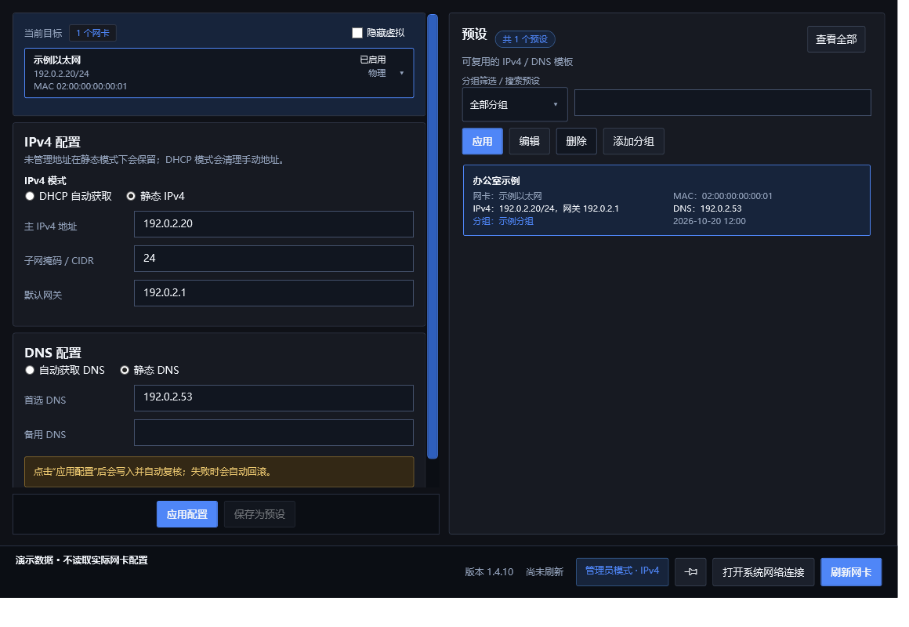

# 网络适配器管理器

Windows 10/11 x64 上的网卡 IPv4、DNS 与预设管理工具，基于 WPF / .NET 8。
当前版本：**1.4.10**，采用 [MIT 许可证](LICENSE)。



## 功能

- 查看物理、虚拟与 VPN 网卡，切换 DHCP / 静态 IPv4、自动 / 静态 DNS。
- 按所属网卡保存、编辑和应用预设，支持分组、搜索、批量换组及删除。
- 写入前获取快照，写入后复核；失败时尝试回滚。
- 启用 / 禁用网卡、窗口置顶、打开系统网络连接。

修改网络配置需要管理员权限，启动时会出现 Windows UAC 提示。
更改当前联网网卡可能中断网络；请先确认目标网卡。

## 下载与使用

在 [GitHub Releases](https://github.com/FlavorFiesta/NetAdapterManager/releases/latest) 选择 Windows x64 包：

- `NetAdapterManager-v1.4.10-portable-win-x64.zip`：完整解压后运行 `NetAdapterManager.exe`。
- `NetAdapterManager-v1.4.10-Setup-win-x64.exe`：安装向导，默认安装到 `%LocalAppData%\Programs\NetAdapterManager`。

发布包自带 .NET 运行时，无需另装运行时。免安装版必须保留解压出的全部文件，不能只复制 EXE。
本仓库不包含预生成二进制，公开下载以实际发布的 Release 为准。

## 数据与隐私

数据保存在程序目录：`presets.json`、`preset-groups.json`、`managed-addresses.json`；
错误日志位于 `logs/NetAdapterManager.log`。升级时保留数据，卸载后可能仍保留运行时生成的文件。
首次使用旧版数据时，会读取并迁移 `%AppData%\NetAdapterManager` 中的这三类 JSON。

预设和截图可能包含网卡名称、MAC、IP、DNS 等信息。提交问题前请脱敏；
这些运行数据、编译输出和本地测试证据已纳入 `.gitignore`。
本页截图由自测使用虚构网卡与文档示例地址生成。

## 构建

需要 Windows 10/11 x64 和 .NET 8 SDK。主程序构建不需要 Python 或 Inno Setup。

```powershell
dotnet restore .\NetAdapterManager.csproj
dotnet build .\NetAdapterManager.csproj -c Release --no-restore
```

默认自测只读取系统网络状态，并在测试输出目录写入测试文件和日志。
命令生成验证使用虚构快照与捕获器，不执行 netsh，不应用真实网卡配置：

```powershell
dotnet run --project .\tests\NetAdapterManager.SelfTest -c Release
powershell -NoProfile -ExecutionPolicy Bypass -File .\tests\Run-FullTest.ps1
```

UI 自测使用演示数据；全功能脚本的 WMI 检查仍需要本机存在网卡，
不适用于所有无硬件的 CI 环境。GitHub Actions 默认执行构建与依赖漏洞查询。

真实写入 / 回滚测试必须显式指定 `-RunSafeWriteTest`，并使用管理员 PowerShell。
它仅允许无默认网关、已有静态 IPv4 的安全虚拟网卡，排除 Wi-Fi 和物理网卡；
不要在当前联网网卡上执行写入测试。

## 打包

额外需要 Python 3、Pillow 11.1.0 和 Inno Setup 6.5.0+（6.x）：

```powershell
python -m pip install -r .\build\requirements.txt
powershell -NoProfile -ExecutionPolicy Bypass -File .\build\Build-Packages.ps1
```

正式包为 `win-x64`、自包含、多文件、不裁剪。
默认输出到 `artifacts\1.4.10\`，临时目录自动清理；最终生成 ZIP 和安装 EXE。
重建只覆盖这两个指定产物，保留目录中的其他文件。
`-OutputRootOverride` 只能指定项目 `artifacts` 下的子目录，不允许路径中包含符号链接或目录联接。
版本从主项目读取并传给安装脚本。

打包会按实际依赖版本收集许可与第三方声明，并检查发布目录没有预设或日志。
请将完整 ZIP、安装包及对应 SHA-256 发布到 Release，不要打包运行过的程序目录。
安装器目录中的 C# 工程是旧原型，正式构建使用 `.iss`，详见 [安装器说明](Installer/README.md)。

## 贡献与反馈

欢迎提交 Issue 和 Pull Request。请描述系统版本、操作步骤、预期与实际结果；
附日志或截图前删除个人信息。提交代码前运行构建和默认自测，真实网卡写入测试不作为普通贡献的前提。

版本变化见 [CHANGELOG](CHANGELOG.md)，第三方材料见 [THIRD-PARTY-NOTICES](THIRD-PARTY-NOTICES.md)。
内部项目记录与原始验收日志仅在本地保留，不作为公开源码提交。
