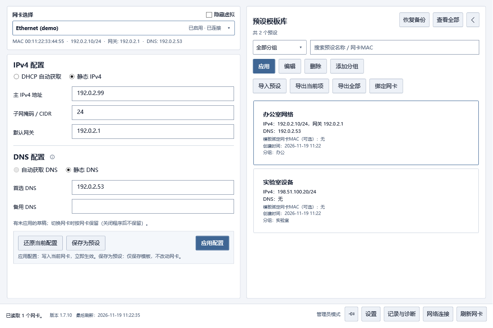
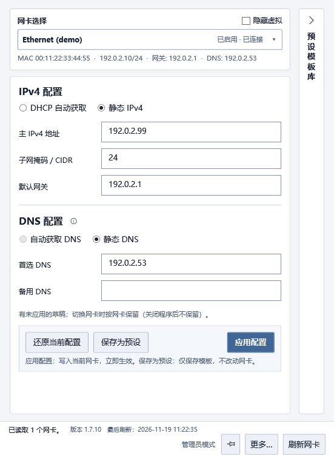
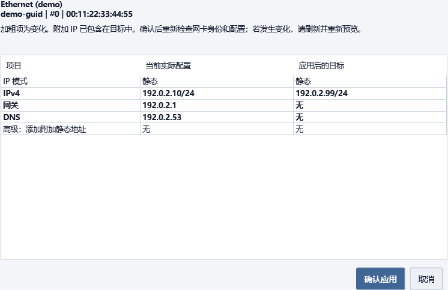

<p align="center">
  
</p>

<h1 align="center">网络适配器管理器</h1>

<p align="center"><strong>为 Windows 网卡切换 IPv4、DNS 和网络预设。</strong></p>

<p align="center">
  <a href="https://github.com/FlavorFiesta/NetAdapterManager/releases/latest"><strong>下载最新版</strong></a>
  · <a href="#快速上手">快速上手</a>
  · <a href="CHANGELOG.md">更新记录</a>
  · <a href="README.en.md">English</a>
</p>

<p align="center">
  <a href="https://github.com/FlavorFiesta/NetAdapterManager/actions/workflows/build.yml"></a>
  · <strong>Windows 10 / 11 x64</strong> · <a href="LICENSE">MIT</a>
</p>

<picture>
  <source media="(prefers-color-scheme: dark)" srcset="docs/images/main-window-dark.png">
  
</picture>

<sub>截图来自 v1.7.10，使用虚构网卡与文档示例地址。</sub>

## 下载

从 [GitHub Releases](https://github.com/FlavorFiesta/NetAdapterManager/releases/latest) 选择 Windows x64 包。两种包均自带 .NET 运行时。

| 下载选项 | 使用方式 |
| --- | --- |
| **安装版 · EXE** | 运行安装向导。开始菜单和桌面快捷方式默认勾选，默认安装到 `%LocalAppData%\Programs\NetAdapterManager`。 |
| **便携版 · ZIP** | 完整解压后运行 `NetAdapterManager.exe`，保留同目录下的所有文件。 |
| **校验清单** | `SHA256SUMS.txt` 包含安装包和便携包的 SHA-256。 |

## 快速上手

1. 启动程序并确认 Windows 管理员授权。
2. 选择目标网卡，核对网卡名称及当前 IPv4、网关和 DNS。
3. 按需修改设置，点 **应用配置** 查看变更预览并确认。想留着下次使用时，点 **保存为预设**。

> 切换当前正在联网的网卡可能中断连接。应用前请核对目标网卡和预览中的配置。

## 主要功能

| 功能 | 可以做什么 |
| --- | --- |
| **网卡与地址** | 查看物理、虚拟和 VPN 网卡，切换 DHCP 或静态 IPv4，设置自动或手动 DNS。DHCP 附加静态地址位于「设置 → 高级」。 |
| **预设模板库** | 保存、搜索、分组、绑定和导入导出预设。收起模板库后，主窗口会随之缩窄。 |
| **变更预览与复核** | 写入前对比当前配置和目标配置，写入后复核，失败时尝试回滚。可在「记录与诊断」中查看结果。 |
| **桌面使用** | 支持浅色、深色和高对比度，提供简体中文、繁体中文和英文。可设置关闭窗口时退出或收进系统托盘。 |

<details>
<summary><strong>查看更多截图：紧凑模式和配置预览</strong></summary>

**收起模板库**



**应用前预览**



</details>

## 数据与隐私

预设、设置和日志保存在程序目录，升级时会保留这些数据。发布诊断信息、日志或截图前，请检查是否含有网卡名、MAC、IP 或 DNS 等信息。

<details>
<summary>本地文件与旧版迁移</summary>

- `preset-library.json` 保存预设和分组，`settings.json` 保存偏好，`managed-addresses.json` 记录程序管理的地址。日志位于 `logs/NetAdapterManager.log`。
- 程序会保留上一份数据文件（`.bak`）。发现预设库损坏时，程序会阻止覆盖。
- 统一预设库首次保存前可读取旧的 `presets.json` 和 `preset-groups.json`，也兼容从 `%AppData%\NetAdapterManager` 读取旧数据。降级或手动替换文件前，请备份整个程序目录。

</details>

## 从源码构建

需要 Windows 10/11 x64 和 .NET 8 SDK。

```powershell
dotnet build .\NetAdapterManager.csproj -c Release
```

<details>
<summary>隔离测试和打包</summary>

```powershell
dotnet build .\tests\NetAdapterManager.SelfTest -c Release
dotnet .\tests\NetAdapterManager.SelfTest\bin\Release\net8.0-windows\NetAdapterManager.SelfTest.dll --isolated
dotnet .\tests\NetAdapterManager.SelfTest\bin\Release\net8.0-windows\NetAdapterManager.SelfTest.dll --appearance-smoke
```

隔离回归和界面冒烟测试使用合成数据。真实网卡写入测试需要管理员 PowerShell，并在 `tests/Run-FullTest.ps1` 中明确启用 `-RunSafeWriteTest`。仅允许无默认网关、已有静态 IPv4 的虚拟网卡。

打包额外需要 Python 3 和 Inno Setup 6.5.0+（6.x）。产物位于 `artifacts\<版本>\`。

```powershell
python -m pip install -r .\build\requirements.txt
powershell -NoProfile -ExecutionPolicy Bypass -File .\build\Build-Packages.ps1
```

详见 [安装器说明](Installer/README.md) 和 [更新源说明](docs/UPDATE-FEED.md)。

</details>

## 反馈与贡献

欢迎提交 [Issue](https://github.com/FlavorFiesta/NetAdapterManager/issues) 或 Pull Request。反馈时请提供 Windows 版本、复现步骤、预期与实际结果，并先对附件脱敏。

[MIT 许可证](LICENSE) · [第三方声明](THIRD-PARTY-NOTICES.md) · [完整更新记录](CHANGELOG.md)
